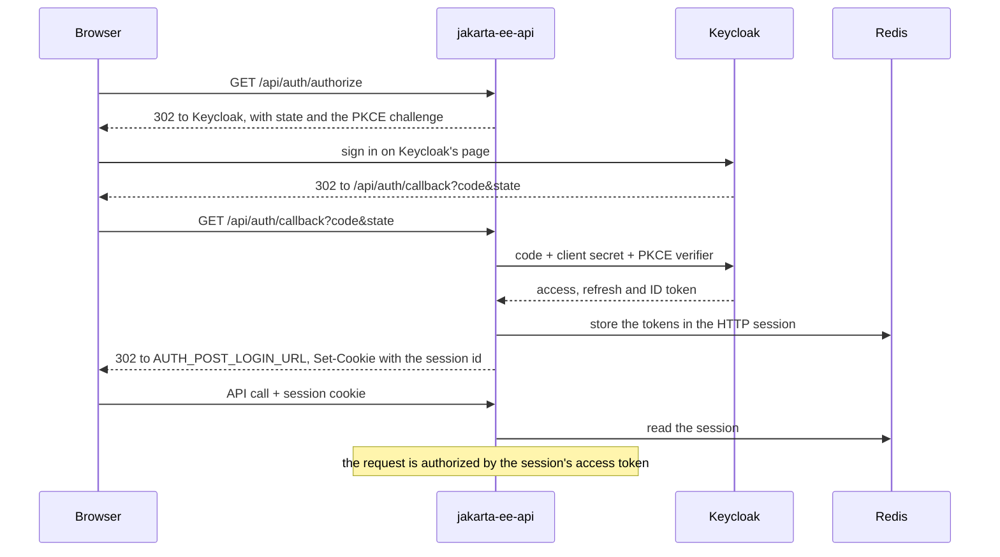

# Authentication

The application never handles a credential. Keycloak (realm `jakarta-ee-api`) owns every page that touches one:
sign-up, sign-in, email verification, password reset, two-factor authentication and acceptance of the terms of use.
The application is a BFF: it runs the sign-in, keeps the tokens on the server and gives the browser only a session
cookie.

## Signing in

1. The browser opens `GET /api/auth/authorize`. `BrowserSessions` stores a fresh `state` and PKCE verifier in the HTTP
   session, and the browser is redirected to Keycloak with the challenge. Optional parameters pass through:
   `register=true` opens the sign-up page, and `kc_action` starts one of `CONFIGURE_TOTP`, `UPDATE_PASSWORD` or
   `delete_credential:<id>`, with a credential's UUID, which Keycloak asks to confirm; any other value is dropped. The
   languages of `Accept-Language` go to Keycloak as `ui_locales`, by their weight, at most ten, leaving out any weighted
   `q=0` and anything that is not a language subtag, and Keycloak shows the first one the realm supports.
2. Keycloak returns to `GET /api/auth/callback`. The application checks that the `state` is the one it issued to this
   browser and `KeycloakTokenClient` exchanges the code with the confidential client and its secret.
3. `SessionService` mirrors the account into MongoDB and the tokens go into the HTTP session; the browser lands on
   `AUTH_POST_LOGIN_URL`. When the account cannot be written, the Keycloak session is ended again. Any failure redirects
   with `?error=sign_in_failed`, and a `state` this browser was not given with `?error=state_mismatch`.

The browser holds only the `JAKARTA_EE_API_SESSION` cookie: `HttpOnly`, `SameSite=Lax`, `Secure` unless
`session_cookie_secure=false` (the local setting).

## Every request is authorized by a token

`KeycloakAuthenticationFilter` takes the access token from `Authorization: Bearer` or, for a browser, from its session.
`TokenVerifier` checks it with Nimbus JOSE + JWT: the signature against Keycloak's published keys, the issuer, the
expiry and the audience (`KEYCLOAK_AUDIENCE`). The roles come from `realm_access.roles`, and the caller becomes the
request's `SecurityContext`, which `RoleAuthorizationFilter` and `@RolesAllowed` read.

Either way the decision rests on the token alone, so any instance can serve any request.

## Sessions and refreshing

The HTTP session lives in Redis, and its access token is refreshed once per refresh token, across instances: [Token
refresh](mechanisms/token-refresh.md).

## Signing out

`POST /api/auth/logout` revokes the refresh token at Keycloak, which ends the Keycloak session, and invalidates the HTTP
session.

## Cross-site requests

An unsafe request from another site gets no token: [Cross-site requests](mechanisms/cross-site-requests.md).

## The sign-in pages

Keycloak draws the sign-in, sign-up, password reset and second-factor pages, and the mails it sends, with the theme in
[`keycloak/themes/jakarta-ee-api`](../keycloak/themes/jakarta-ee-api), so they carry the API's name and legal pages:

| Part                      | Holds                                                                                 |
|---------------------------|---------------------------------------------------------------------------------------|
| `login/theme.properties`  | extends `keycloak.v2`, whose templates draw every page, and names the legal pages     |
| `login/template.ftl`      | the page frame: a top bar with the name and the menus, a footer with the legal pages  |
| `login/resources`         | `css/app.css`, the colors, type and card on PatternFly; `js/theme.js`, the theme menu |
| `login/messages`          | the texts of the bar and the footer, in Polish and English                            |
| `email/html/template.ftl` | the frame of every mail; its texts stay Keycloak's own                                |

The theme menu offers System, Light and Dark; without a choice the pages follow the reader's system. The choice is kept
in the browser for Keycloak's address. A realm that turns dark mode off gets the light theme and no menu.

`template.ftl` is a copy of `keycloak.v2`'s own, changed only where it says `Changed from keycloak.v2`. Keycloak builds
its pages from that template, so after an upgrade of Keycloak the copy is compared with the new release's and brought up
to date. The Keycloak theme workflow does the comparison: `keycloak/check-template.sh` fails when the template in the
Keycloak image of `docker-compose.local.yml` is not the one the copy was made from, recorded as `parentTemplateSha256`
in `theme.properties`, which changes with the copy. The colors are neutral ones, as the API has no front-end of its own.
A mail's colors are written as hex, since mail clients read neither `oklch()` nor `light-dark()`. The links of the bar
and the footer lead to the client's base URL, `baseUrl` in the realm.

The realm names the theme in `loginTheme` and `emailTheme`. Locally, compose mounts the folder into Keycloak. A Keycloak
that serves several applications, each in its own realm, takes it as a JAR in `/opt/keycloak/providers`:
`keycloak/build-theme.sh` writes `keycloak/target/jakarta-ee-api-keycloak-theme.jar`, and `keycloak/Dockerfile` builds
an image holding it in `/themes`, which the Keycloak theme workflow publishes on a `keycloak-theme-v*` tag.

## Code

All in `modules/app/src/main/java/com/vertyll/jakartaeeapi/auth`:

| Class                          | Role                                                                |
|--------------------------------|---------------------------------------------------------------------|
| `AuthResource`                 | authorize, callback, session, logout                                |
| `BrowserSessions`              | what the HTTP session holds: the sign-in in progress and the tokens |
| `SessionService`               | sign-in with the account mirror, refresh, sign-out                  |
| `SignedInAccounts`             | the account mirror a sign-in calls, kept by `user/SignedInUsers`    |
| `KeycloakTokenClient`          | code exchange, refresh, revocation                                  |
| `SharedRefreshes`              | one refresh per refresh token across instances                      |
| `TokenVerifier`                | token verification against Keycloak's keys                          |
| `KeycloakAuthenticationFilter` | turning a bearer token or a session into a caller                   |
| `RoleAuthorizationFilter`      | `@PermitAll`, `@DenyAll`, `@RolesAllowed`                           |
